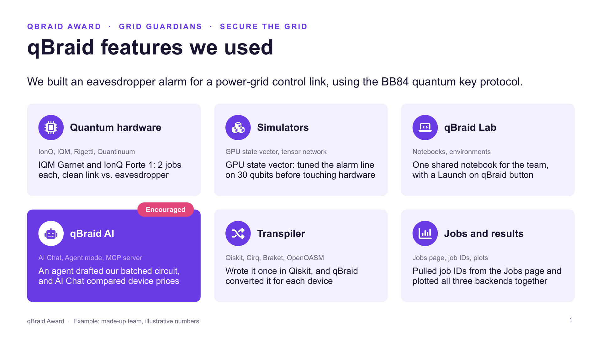
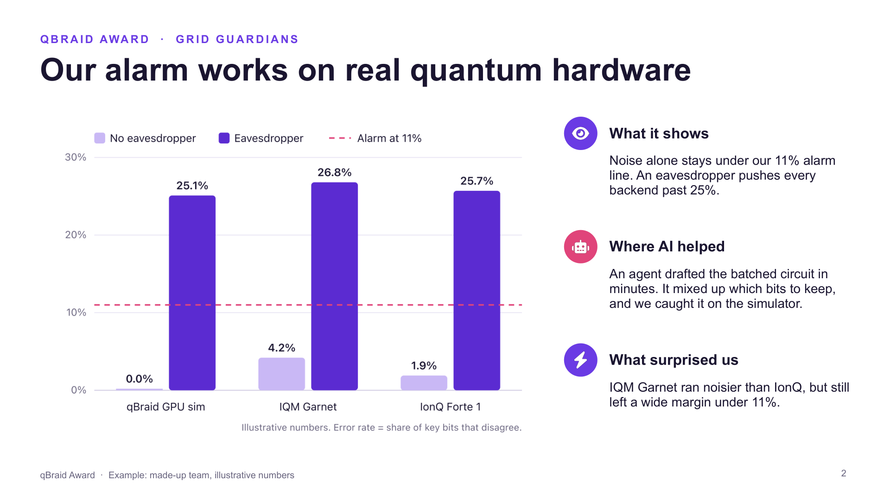
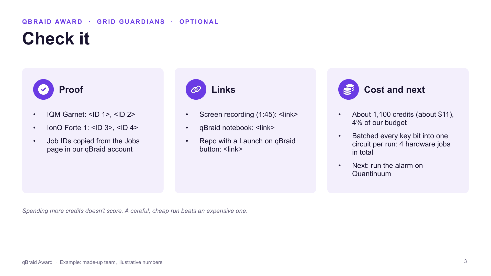
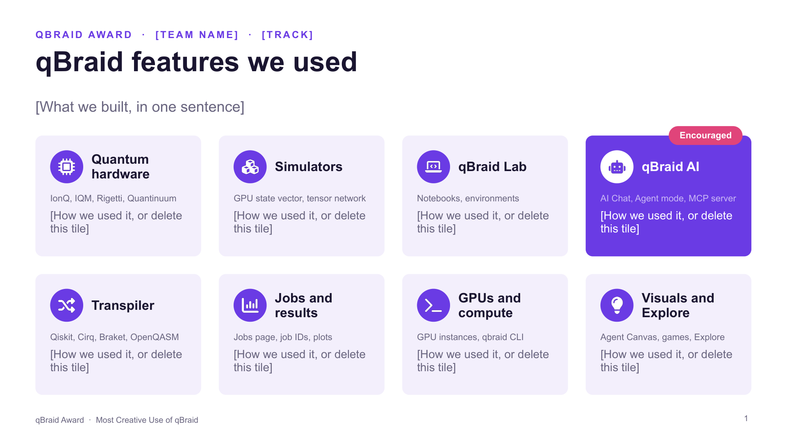

[](https://account.qbraid.com?gitHubUrl=https://github.com/qBraid/qbraid-award.git)

# qBraid Award: Most Creative Use of qBraid

The qBraid Award goes to the team that makes the most creative use of [qBraid](https://account.qbraid.com) at your hackathon. It's not a separate challenge: any team in any track can win it with the project you're already building. To enter, you send us **2 or 3 slides** on how you used qBraid.

| | |
|---|---|
| **Who can enter** | Every team, in every track |
| **What you submit** | 2 or 3 slides from [our template](./template/qbraid-award-template.pptx), plus optional extras (screen recording, qBraid link, repo, job IDs) |
| **Where** | The entry form for your event ([below](#your-event)) |
| **Prize** | $200 in gift cards split across the winning team, plus 1,000 qBraid credits for each member |
| **Judged on** | Creative, Real, Clear ([details](#how-we-judge)) |

**Contents:** [Your event](#your-event) · [How to enter](#how-to-enter) · [Ideas](#ideas-for-using-qbraid) · [The slides](#the-slides) · [Extras](#optional-extras) · [Code you can copy](#code-you-can-copy) · [How we judge](#how-we-judge) · [Checklist](#before-you-submit) · [FAQ](#faq) · [Links](#links)

---

## Your event

| Event | Dates | Entries due | Entry form | Discord |
|---|---|---|---|---|
| Intermountain Quantum Competition (BYU, Provo) | Nov 6 to 7, 2026 | **Sat Nov 7, 9:00am MST** | [Alex to add: form link] | [Join](https://discord.gg/7mWPs3HGc) |
| TN Quantum Hackathon, Chattanooga | Nov 13 to 15, 2026 | **Sunday 9:00am**, with your final submission | [Alex to add: form link] | [Alex to add: Discord link] |

**Intermountain Quantum Competition:** the award sits on top of whichever sponsor challenge your team is on. To get free credits and real hardware, join the IQC organization on qBraid with the invite link [Alex to add: org invite link]. qBraid gives a live platform walkthrough on Friday at 11:15am MST. Entries are due Saturday at 9:00am MST, before the 3:00pm presentations, and the winner gets a certificate at the 5:00pm awards.

**TN Quantum Hackathon:** the winner is announced at the closing ceremony at The Landing Social House. If you want to run on Quantinuum through qBraid, each team member first creates a Quantinuum Nexus account and accepts its terms, which takes under a minute. Everyone who completes the weekend also gets a qBraid completion certificate with a verification link.

---

## How to enter

1. **Use qBraid in your project.** You don't need to change what you're building. Use qBraid where it helps.
2. **Make 2 or 3 slides** from the [PowerPoint template](./template/qbraid-award-template.pptx) ([details below](#the-slides)). Share them from Google Slides, PowerPoint or as a PDF, and make sure anyone with the link can view them.
3. **Fill in the entry form** for your event before the deadline. Include the link to your slides, any extras, and the qBraid account email of one team member, so we can find your runs and send the prize. It takes about three minutes, and you can edit your entry until the deadline.

---

## Ideas for using qBraid

Any of these can be the core of a strong entry. One used well beats all of them used briefly.

- **Run on real quantum hardware.** Send your circuit to a QPU and compare the result with a simulator. Prices and live status for every device are in the [device catalog](https://account.qbraid.com/devices).
- **Use AI on qBraid (encouraged).** Ask [AI Chat](https://docs.qbraid.com/v2/ai/user-guide/overview) in your qBraid account to compare devices or explain a result, run a coding agent with Agent mode, or connect your own AI tool (Claude, Cursor, VS Code) to qBraid through the MCP server at `https://mcp.qbraid.com/mcp`. Show what you had it do and where you stepped in.
- **Push past your laptop with GPU simulators.** qBraid's GPU state-vector simulator handles circuits up to 35 qubits.
- **Compare devices.** Run the same circuit on two different kinds of hardware, superconducting and trapped-ion for example, and explain the difference.
- **Write once, run anywhere.** Write in Qiskit, Cirq, Braket or OpenQASM and run on a device that expects another format. The [qBraid transpiler](https://docs.qbraid.com/sdk/user-guide/transpiler) handles the conversion.
- **Make it reproducible.** Put your work in a repo with a Launch on qBraid button so anyone can open it in [qBraid Lab](https://docs.qbraid.com/lab/user-guide/getting-started) in one click.

**What doesn't count on its own:** signing up, running local code in a qBraid notebook, copying a tutorial unchanged, or a single "hello world" job unconnected to your project.

---

## The slides

**Download the template:** [`qbraid-award-template.pptx`](./template/qbraid-award-template.pptx). It opens in PowerPoint, Keynote or Google Slides (in Google Drive, choose New > File upload, then open the file with Google Slides). Fill in the brackets, delete what you don't need, and share a link anyone can view.

**See a finished example:** [`qbraid-award-example.pptx`](./template/qbraid-award-example.pptx), or [as a PDF](./template/qbraid-award-example.pdf). The team is made up and the numbers are illustrative.

Two slides are required and the third is optional.

### Slide 1: qBraid features we used (required)



- Start with your project in one sentence.
- The template has a tile for each qBraid feature: quantum hardware, simulators, qBraid Lab, **qBraid AI**, the transpiler, jobs and results, the CLI and compute, and one for your own idea. **Keep a tile for every feature you used**, write a line on how you used it, and delete the rest.
- AI is encouraged. Say what you had it do and where you stepped in.

### Slide 2: Our best qBraid moment (required)



- **One** chart or screenshot of the result you're proudest of. Comparisons work best: simulator against hardware, one device against another, small circuits against large ones. A `plot_histogram` screenshot is perfect ([code below](#code-you-can-copy)).
- **What it shows:** a sentence or two someone outside quantum can follow.
- **Where AI helped:** what you asked an AI tool to do, and what you fixed or checked yourself.
- **What surprised us:** optional.

### Slide 3: Check it (optional)



- **Proof:** your job IDs, from the [Jobs page in your qBraid account](https://docs.qbraid.com/v2/account/quantum-jobs) or `print(job.id)` in your notebook.
- **Links:** a screen recording, a qBraid notebook, project, job or artifact, or your repo.
- **Cost and next:** roughly what it cost in credits, how you kept it low, and what you'd try next.

This is what the blank template looks like:



---

## Optional extras

None of these are required, but they help us see that your work really ran on qBraid. Put the links on slide 3 or in the entry form.

- **A screen recording of 2 minutes or less**, showing your notebook running on qBraid or your results coming back. On a Mac, press Cmd+Shift+5. On Windows, use the Snipping Tool's record option. [Loom](https://www.loom.com) also works. Upload it as unlisted to YouTube, or to Google Drive with "anyone with the link" access.
- **A qBraid link:** a notebook, project, job or artifact.
- **Your repo with a Launch on qBraid button.** Add this to your README and swap in your username and repo:

  ```markdown
  [](https://account.qbraid.com?gitHubUrl=https://github.com/<your-username>/<your-repo>.git)
  ```

---

## Code you can copy

This runs one circuit on qBraid's GPU simulator and on real hardware, prints the job IDs for slide 3, and draws the comparison chart for slide 2. Swap in your own circuit and device. Device IDs are in the [device catalog](https://account.qbraid.com/devices).

```python
from qbraid.runtime import QbraidProvider
from qbraid.visualization import plot_histogram

provider = QbraidProvider()  # in qBraid Lab, your account is picked up automatically

sim = provider.get_device("qbraid:qbraid:sim:gpu-sv")  # qBraid GPU simulator
qpu = provider.get_device("aws:iqm:qpu:garnet")        # real hardware: check the price first

sim_job = sim.run(circuit, shots=1000)
qpu_job = qpu.run(circuit, shots=200)
print(sim_job.id, qpu_job.id)  # job IDs for slide 3

sim_counts = sim_job.result().data.get_counts()
qpu_counts = qpu_job.result().data.get_counts()
plot_histogram([sim_counts, qpu_counts])  # simulator vs. hardware chart for slide 2
```

More in the docs: [running on qBraid](https://docs.qbraid.com/sdk/user-guide/providers/native), [working with jobs](https://docs.qbraid.com/sdk/user-guide/providers/jobs) and [plotting results](https://docs.qbraid.com/sdk/user-guide/visualization).

**Save credits and time:**

- Get your circuit right on a simulator before you send it to hardware.
- Hardware charges per job plus per shot, so pack as much as you can into each job and choose your shot count on purpose.
- Hardware queues can be long, so send hardware jobs early in the event, not an hour before the deadline.

---

## How we judge

qBraid staff judge the award after the deadline, separately from track judging. We look at your slides and extras, check that your runs happened on qBraid during the event, and score three things from 1 to 5:

| | What a 5 looks like |
|---|---|
| **Creative** | You used qBraid in a way we didn't expect, or in a way that fits your problem really well |
| **Real** | It ran on qBraid during the event, and it matters to your result: take qBraid out and your conclusion changes |
| **Clear** | From your slides alone, we can quickly see what qBraid did for you |

- **Spending more credits doesn't help.** A careful, cheap hardware run beats an expensive one.
- **Using AI is encouraged.** Smart use of AI counts toward Creative, as long as you show where you checked its work.
- Extras don't earn points by themselves, but they make "Real" easy for us to confirm.
- The highest total wins, and ties go to Creative.

---

## Before you submit

- [ ] 2 or 3 slides, and the link opens for anyone
- [ ] Slide 1 keeps a tile for each qBraid feature you used, with the devices and tools named
- [ ] Slide 2 has one clear chart or screenshot, a plain-English takeaway, and where AI helped (if you used it)
- [ ] Job IDs or another link we can check (optional, but it helps)
- [ ] The entry form is filled in, with one team member's qBraid email, before the deadline

---

## FAQ

**Do we have to change our project?** No. Show how qBraid fits into what you're already building.

**Does entering affect our track judging?** No. The award is judged separately, and your track result doesn't affect it.

**We only used simulators. Can we still win?** Yes. Hardware isn't required, and a creative use of the simulators counts.

**Can we use AI?** Yes, please. Tell us on slide 2 what it did and where you stepped in.

**Can we edit our entry after submitting?** Yes, until the deadline.

**How do we get the prize if we win?** We announce the winner at the event and email the team through the qBraid email on your entry.

---

## Links

- [qBraid account](https://account.qbraid.com) and [device catalog](https://account.qbraid.com/devices)
- [qBraid docs](https://docs.qbraid.com) and [getting started in qBraid Lab](https://docs.qbraid.com/lab/user-guide/getting-started)
- [qBraid SDK on GitHub](https://github.com/qBraid/qBraid)
- Slides: [template (.pptx)](./template/qbraid-award-template.pptx) · [example (.pptx)](./template/qbraid-award-example.pptx) · [example (PDF)](./template/qbraid-award-example.pdf)
- [qBraid AI](https://docs.qbraid.com/v2/ai/user-guide/overview) (AI Chat, Agent mode, MCP server) and the [qBraid CLI](https://docs.qbraid.com/v2/cli/user-guide/overview)
- Questions: ask a qBraid mentor at your event or in your event's Discord ([Intermountain](https://discord.gg/7mWPs3HGc)), or email alex@qbraid.com
