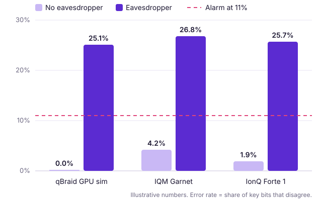

# Example showcase: "Grid Guardians", Secure the Grid track

> **This is an example.** The team is made up and the results are illustrative: they show the format and level of detail judges want, not real measurements. Prices are qBraid's listed rates on Oct 26, 2026. The same content as slides is in [`../template/slides-preview.html`](../template/slides-preview.html).

---

## 1. What qBraid did for us

- **Our project in one sentence:** an eavesdropper alarm for a power-grid control link, built on the BB84 quantum key distribution protocol.
- **Where each step ran:**

  `Qiskit notebook in qBraid Lab` → `qBraid GPU state-vector simulator` (tune the alarm on 30 qubits) → `IQM Garnet` (2 jobs) → `IonQ Forte 1` (2 jobs, cross-check)

- **What qBraid made possible:** we tested the same alarm on a simulator and two different kinds of quantum hardware, superconducting and trapped-ion, from one notebook without rewriting the circuit.

## 2. Our best qBraid moment

- **The takeaway:** hardware noise alone keeps the error rate under our 11% alarm line on both devices. An eavesdropper pushes every backend past 25%, so the alarm works on real hardware, not just in simulation.

## 3. Check it

- **qBraid job IDs:** `<job ID 1>`, `<job ID 2>`, `<job ID 3>`, `<job ID 4>` (copied from the qBraid Jobs page)
- **Devices and simulators used:** qBraid GPU state-vector simulator, IQM Garnet, IonQ Forte 1
- **Credits used:** about 1,100 credits (about $11), or 4% of our team's budget. We packed every bit into one batched circuit per run, so each device needed 2 jobs instead of one job per qubit.

  | Run | Cost |
  |---|---|
  | GPU simulator, about 6 minutes | 30 credits |
  | IQM Garnet, 2 jobs × 500 shots | 205 credits |
  | IonQ Forte 1, 2 jobs × 50 shots | 860 credits |

- **Run it yourself:** `github.com/<team>/grid-guardians`, which has a Launch on qBraid button
- **Next:** run the same alarm on Quantinuum, and check how far the alarm line can drop before noise alone sets it off.
